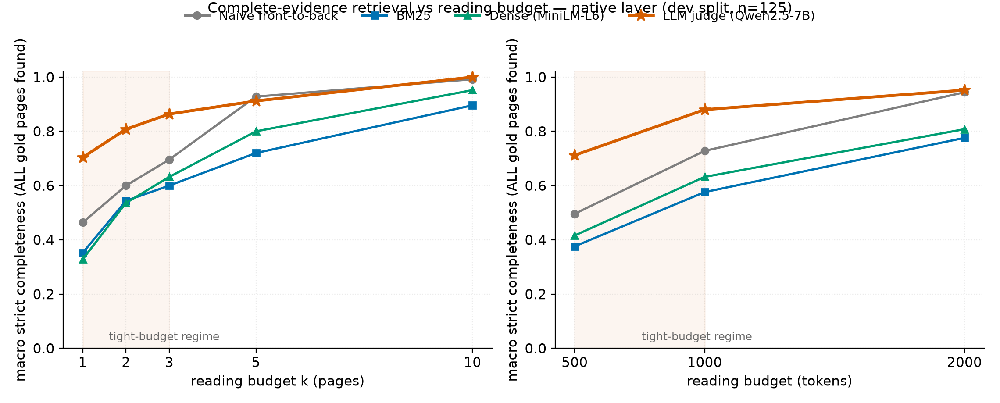
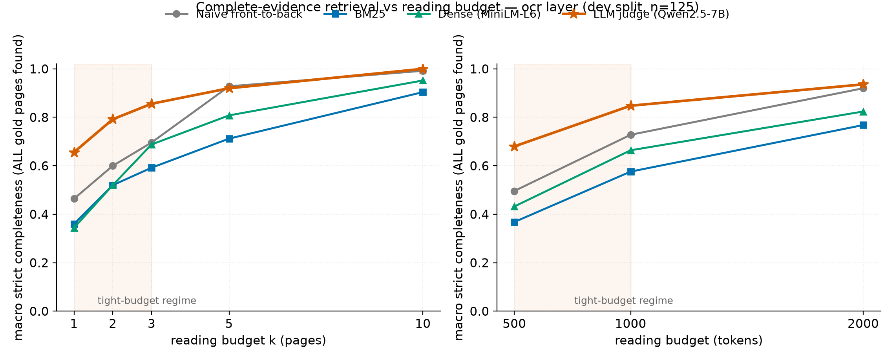

# Completeness vs budget — all baselines (meeting figure pack)

Dev split, 125 evidence-bearing instances. Every number read from the frozen baseline
JSONs (`bm25_baseline.json`, `dense_baseline.json`, `llm_reranker_qwen7b.json`); nothing
recomputed. Regenerate with `~/ds_env/bin/python farit/src/analysis/budget_curves.py`.

## How to read the curves

1. **The interesting regime is k<=3 pages / <=1000 tokens.** By k=10 everything except BM25
   saturates (naive 0.992, dense 0.952, judge 1.000) — with no budget, completeness is trivial.
2. **At k=1-3 the cheap methods collapse but the judge holds up.** complete@1: judge 0.704 vs
   naive 0.464, BM25 0.352, dense 0.328; at @1000tok the gap is 0.880 vs 0.728/0.576/0.632.
3. **Strict completeness trails lenient piece-recall for every cheap method** (e.g. BM25 @3:
   0.600 vs 0.612) — OR-acceptance-style scoring
   systematically overstates what a retriever really covers. The judge gap is smallest because
   it finds whole sets *for explicit fields*; its failure mode is different (derived premises —
   see `derived_case_studies.md`).
4. **Native and OCR curves are nearly identical** — again, the bottleneck is not the text layer.

## Tables

### native layer — macro strict completeness (source: frozen JSON)

| Method | @1 | @2 | @3 | @5 | @10 | @500tok | @1000tok | @2000tok |
|---|---|---|---|---|---|---|---|---|---|
| Naive front-to-back | 0.464 | 0.600 | 0.696 | 0.928 | 0.992 | 0.496 | 0.728 | 0.944 |
| BM25 | 0.352 | 0.544 | 0.600 | 0.720 | 0.896 | 0.376 | 0.576 | 0.776 |
| Dense (MiniLM-L6) | 0.328 | 0.536 | 0.632 | 0.800 | 0.952 | 0.416 | 0.632 | 0.808 |
| LLM judge (Qwen2.5-7B) | 0.704 | 0.808 | 0.864 | 0.912 | 1.000 | 0.712 | 0.880 | 0.952 |

### native layer — lenient piece-recall (for the completeness gap)

| Method | @1 | @2 | @3 | @5 | @10 | @500tok | @1000tok | @2000tok |
|---|---|---|---|---|---|---|---|---|---|
| Naive front-to-back | 0.492 | 0.620 | 0.736 | 0.952 | 0.996 | 0.520 | 0.756 | 0.948 |
| BM25 | 0.372 | 0.552 | 0.612 | 0.740 | 0.912 | 0.392 | 0.576 | 0.796 |
| Dense (MiniLM-L6) | 0.376 | 0.588 | 0.668 | 0.816 | 0.972 | 0.460 | 0.664 | 0.836 |
| LLM judge (Qwen2.5-7B) | 0.756 | 0.844 | 0.896 | 0.936 | 1.000 | 0.760 | 0.904 | 0.964 |

### ocr layer — macro strict completeness (source: frozen JSON)

| Method | @1 | @2 | @3 | @5 | @10 | @500tok | @1000tok | @2000tok |
|---|---|---|---|---|---|---|---|---|---|
| Naive front-to-back | 0.464 | 0.600 | 0.696 | 0.928 | 0.992 | 0.496 | 0.728 | 0.920 |
| BM25 | 0.360 | 0.520 | 0.592 | 0.712 | 0.904 | 0.368 | 0.576 | 0.768 |
| Dense (MiniLM-L6) | 0.344 | 0.520 | 0.688 | 0.808 | 0.952 | 0.432 | 0.664 | 0.824 |
| LLM judge (Qwen2.5-7B) | 0.656 | 0.792 | 0.856 | 0.920 | 1.000 | 0.680 | 0.848 | 0.936 |

### ocr layer — lenient piece-recall (for the completeness gap)

| Method | @1 | @2 | @3 | @5 | @10 | @500tok | @1000tok | @2000tok |
|---|---|---|---|---|---|---|---|---|---|
| Naive front-to-back | 0.492 | 0.620 | 0.736 | 0.952 | 0.996 | 0.520 | 0.740 | 0.944 |
| BM25 | 0.380 | 0.528 | 0.604 | 0.732 | 0.916 | 0.384 | 0.588 | 0.788 |
| Dense (MiniLM-L6) | 0.396 | 0.584 | 0.744 | 0.840 | 0.968 | 0.488 | 0.724 | 0.864 |
| LLM judge (Qwen2.5-7B) | 0.704 | 0.824 | 0.880 | 0.944 | 1.000 | 0.720 | 0.868 | 0.960 |
