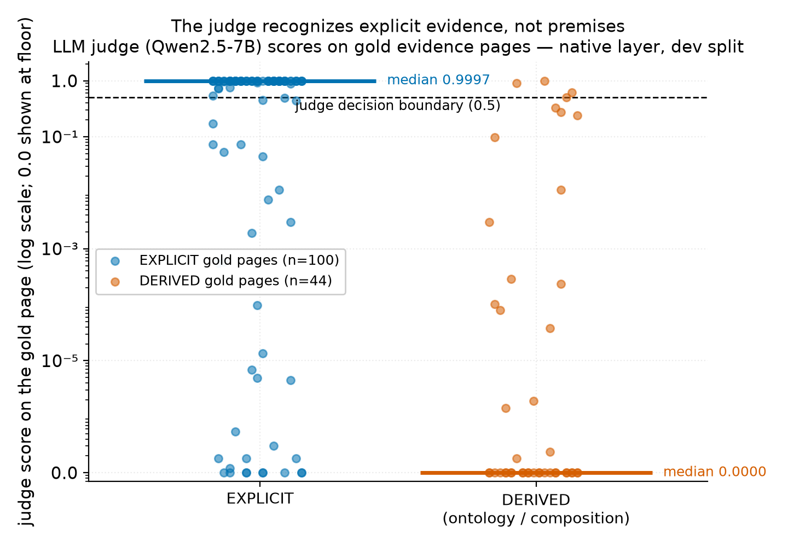

# Case studies — the judge does not recognize derivation evidence

LLM judge (Qwen2.5-7B, pointwise), native layer, dev split, n=125 instances. All numbers read
from frozen outputs (`llm_reranker_qwen7b.json` + `gold_evidence.jsonl`); regenerate with
`~/ds_env/bin/python farit/src/analysis/derived_case_studies.py`.

## Selection rule (deterministic, no cherry-picking)

Of 36 derived (non-EXPLICIT) evidence-bearing instances, **32 (89%) have ALL gold fragment pages below the judge's own 0.5 boundary** — the judge confidently answers 'No' on every page that carries a premise. From each stratum we take the single worst instance by max gold-page score (ties broken by document, field):

| stratum | size | chosen case |
|---|---|---|
| COMPOSITION_IMPLIED | 3 | `sds_20.pdf` / `substance_or_mixture` |
| ONTOLOGY, cross-page | 5 | `sds_03.pdf` / `molecular_weight` |
| ONTOLOGY, same page | 24 | `sds_01.pdf` / `chemical_formula` |

## The picture, in one figure

- EXPLICIT gold pages: n=100, median score **0.9997**, 34% below 0.5.
- DERIVED gold pages: n=44, median score **0.0000**, **91%** below 0.5.

(Pooled over gold pages, deduplicated per instance-page. The 0.9998 quoted in PROGRESS.md is the
median of per-instance medians — same data, different summary; both round to ≈ 1.0 vs 0.0.)

## Cases

### Case 1 — COMPOSITION_IMPLIED (value derived from the composition)

- **Document / field:** `sds_20.pdf` → `substance_or_mixture`
- **Gold value:** `MIXTURE` | **state:** `PRESENT` | **derivation:** `COMPOSITION_IMPLIED` | **cross-page:** False
- **Evidence set:** 1 fragment on page(s) [3]

| page | judge score | gold? | what is on it (fragment text) |
|---|---|---|---|
| 1 | **0.0004583** |  | — |
| 2 | **0.001033** |  | — |
| 3 | **0.2393** | GOLD | ✔ [premise] Petrochemical Stillage Residue KON-92 produced from residuals of ⏎ butyl alcohols, butyl aldehydes, 2-ethylhexanol, 2-ethylhexanoic acid, ⏎ ethylene-propylene copol |
| 4 | **0.8807** |  | — |
| 5 | **0.4766** |  | — |
| 6 | **0.01912** |  | — |
| 7 | **0.3075** |  | — |
| 8 | **0.9262** |  | — |
| 9 | **0.9959** |  | — |
| 10 | **0.001704** |  | — |
| 11 | **0.01973** |  | — |
| 12 | **1.784e-07** |  | — |

**Diagnosis:** The 1 premise fragment on 1 page (p3 = 0.2393) falls below the judge's own 0.5 boundary. Meanwhile 3 non-gold pages score ≥ 0.5 (top: p9 = 0.9959, p8 = 0.9262, p4 = 0.8807). The gold value is never stated in the document — it must be derived from composition premises. The judge's Yes/No question asks 'does this page contain the field?'; premises answer 'why must it be so?', and the judge does not model that second question.

### Case 2 — ONTOLOGY-derived, premises on different pages

- **Document / field:** `sds_03.pdf` → `molecular_weight`
- **Gold value:** `None` | **state:** `NOT_APPLICABLE` | **derivation:** `ONTOLOGY` | **cross-page:** True
- **Evidence set:** 2 fragments on page(s) [1, 2]

| page | judge score | gold? | what is on it (fragment text) |
|---|---|---|---|
| 1 | **0** | GOLD | ✔ [premise] Substance: ⏎ Non-applicable |
| 2 | **0** | GOLD | ✔ [premise] Chemical description: Mixture of polymers, dispersants and organic compounds |
| 3 | **0** |  | — |
| 4 | **0** |  | — |
| 5 | **0** |  | — |
| 6 | **0** |  | — |
| 7 | **0** |  | — |
| 8 | **0** |  | — |
| 9 | **0** |  | — |
| 10 | **0** |  | — |
| 11 | **0** |  | — |

**Diagnosis:** The 2 premise fragments on 2 pages (p1 = 0, p2 = 0) all fall below the judge's own 0.5 boundary. Every one of the 11 pages scores exactly 0.0: the judge's 'ranking' degenerates to document order, so any completeness it shows here is the naive prior, not the model. The value is an ontology-derived NOT_APPLICABLE (rule: form = MIXTURE ⇒ no single identifier/formula/weight per product). The premises are form cues spread over several pages that mention the field name nowhere — so the failure is both structural (cross-page) and semantic (premise vs mention).

### Case 3 — ONTOLOGY-derived, premises on the same page

- **Document / field:** `sds_01.pdf` → `chemical_formula`
- **Gold value:** `None` | **state:** `NOT_APPLICABLE` | **derivation:** `ONTOLOGY` | **cross-page:** False
- **Evidence set:** 2 fragments on page(s) [1]

| page | judge score | gold? | what is on it (fragment text) |
|---|---|---|---|
| 1 | **0** | GOLD | ✔ [premise] Chemical description: Mixture of substances ; [premise] Substance: ⏎ Non-applicable |
| 2 | **0** |  | — |
| 3 | **0** |  | — |
| 4 | **0** |  | — |
| 5 | **0** |  | — |
| 6 | **0** |  | — |
| 7 | **0** |  | — |
| 8 | **0** |  | — |
| 9 | **0** |  | — |

**Diagnosis:** The 2 premise fragments on 1 page (p1 = 0) falls below the judge's own 0.5 boundary. Every one of the 9 pages scores exactly 0.0: the judge's 'ranking' degenerates to document order, so any completeness it shows here is the naive prior, not the model. Both premises sit on the SAME page — so this failure is not spatial at all; it is the page-level 'contains the value?' framing itself: the value here is an absence derived from form cues.

### Contrast — a typical EXPLICIT case (what the judge is actually good at)

- **Document / field:** `sds_19.pdf` → `product_name`
- **Gold value:** `Water Reducer 310` | **state:** `PRESENT` | **derivation:** `EXPLICIT` | **cross-page:** False
- **Evidence set:** 1 fragment on page(s) [1]

| page | judge score | gold? | what is on it (fragment text) |
|---|---|---|---|
| 1 | **1** | GOLD | ✔ [evidence] Trade Name: ⏎ Water Reducer 310 |
| 2 | **0** |  | — |
| 3 | **0** |  | — |
| 4 | **5.93e-08** |  | — |
| 5 | **0** |  | — |
| 6 | **0** |  | — |
| 7 | **0** |  | — |

**Diagnosis:** For stated values the judge is confidently right: gold pages ≈ 1.0, non-gold pages ≈ 0. This is the asymmetry the meeting figure visualizes: the same model, two completely different regimes.

*Note:* 14 of the 36 derived instances have **every page in the document scoring exactly 0.0** — the judge answers a confident 'No' on all of them, and the resulting 'ranking' is just document order. This is the fully-degenerate regime, not a ranking-margin issue.

## Housekeeping — the `Scores outside (0,1)` warning in the reranker report

Across all 1303 scored (field, page) pairs: strictly below 0: 0, strictly above 1: 0; exactly 0.0: 740, exactly 1.0: 13. The warning was a too-strict sanity
check (`min <= 0 or max >= 1`): P(Yes)/(P(Yes)+P(No)) underflows to exactly 0.0/1.0 for extreme
logprob gaps, which is expected saturation, not a logprob-extraction bug. The check in
`llm_reranker.py` now flags only scores strictly outside [0,1] and reports saturation counts.

## What this means for the topic

1. **Recognizing premises is a measurable, open capability gap** — it is not OCR (native layer),
   not ranking noise (the failures are confident near-zero scores), and not solved by scale alone
   in the judge's current zero-shot Yes/No framing.
2. **Judge scores cannot anchor an abstention rule on derived fields** — any calibrated stopping
   rule must model derivation intent, not literal field mentions.
3. **All-zero degeneracy means 'LLM ranking' can hide a naive prior** — methods must be reported
   against tie structure, which our protocol now does.
